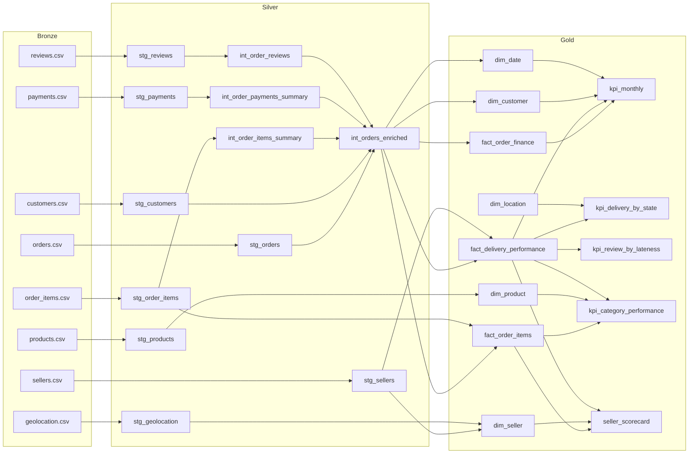

# Architecture

## Medallion layers

| Layer | dbt folder / schema | Materialisation | Purpose |
|---|---|---|---|
| **Bronze** (raw) | `Data/raw/*.csv` | files, read with `read_csv(all_varchar)` | Untouched source files, preserved for audit and reprocessing |
| **Silver** (staging) | `models/staging` → `staging` | tables | Type casting, renaming, trimming, zip-code padding, category translation. One row per source record |
| **Silver** (intermediate) | `models/intermediate` → `intermediate` | views | Business rules: order roll-ups, latest review, revenue recognition, SLA, quarantine |
| **Gold** (core) | `models/marts/core` → `core` | tables | Star schema: 3 facts, 5 dimensions |
| **Gold** (metrics) | `models/marts/metrics` → `metrics` | tables | Governed KPI tables read by dashboards |
| BI | `Dashboards/` | — | Presentation only; no metric logic |

Reference data (Brazilian states and regions) is a dbt seed in the `reference` schema.

## Warehouse targets

| Target | Engine | Data | Used for |
|---|---|---|---|
| `dev` | DuckDB file `warehouse/decisiongrade.duckdb` | full dataset | development and analysis |
| `cloud` | MotherDuck (`md:decisiongrade`) | full dataset | cloud warehouse, deployed by GitHub Actions on every merge to `main` |
| `ci` | DuckDB file `warehouse/ci.duckdb` | 3% sample in `Data/sample` | GitHub Actions on every pull request |

The SQL is the same for all three; only `profiles.yml` changes.

## Lineage

The interactive, column-level version is the dbt docs site in [`dbt_docs/index.html`](dbt_docs/index.html).

## Star schema

| Table | Grain | Keys |
|---|---|---|
| `fact_order_finance` | one order | `customer_key`, `purchase_date_key`, `location_key` |
| `fact_order_items` | one order line | `product_key`, `seller_key`, `customer_key`, `purchase_date_key` |
| `fact_delivery_performance` | one delivered order | `customer_key`, `seller_key`, `purchase_date_key`, customer and seller `location_key` |
| `dim_customer` | one real customer | `customer_key` = md5(`customer_unique_id`) |
| `dim_product` | one product | `product_key` = md5(`product_id`) |
| `dim_seller` | one seller | `seller_key` = md5(`seller_id`) |
| `dim_location` | one state | `location_key` = state code |
| `dim_date` | one day | `date_key` = yyyymmdd integer |

Surrogate keys are generated in the warehouse so facts join to dimensions the same way regardless of how the source identifies the entity.

## Design rules

- Business logic is written once, in the intermediate layer.
- Dashboards do not define metrics.
- Every model has tests in its `.yml` file; keys are tested for uniqueness and referential integrity.
- Thresholds are dbt variables, so changing one is a reviewed code change.
