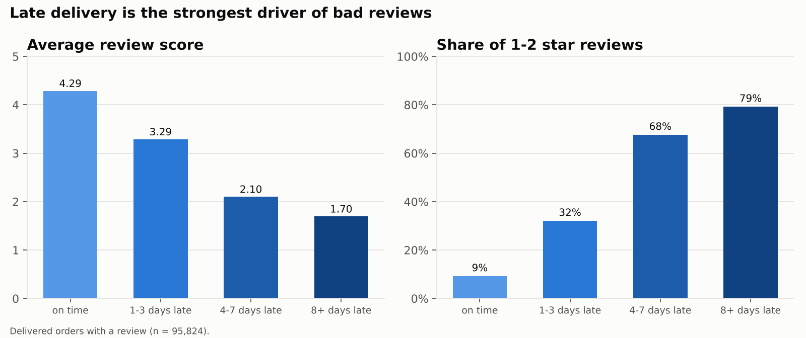
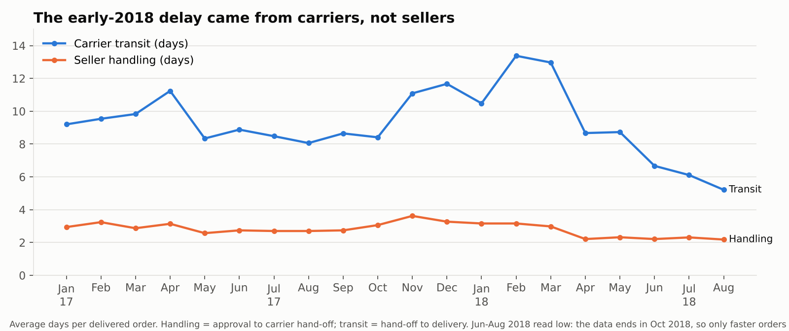
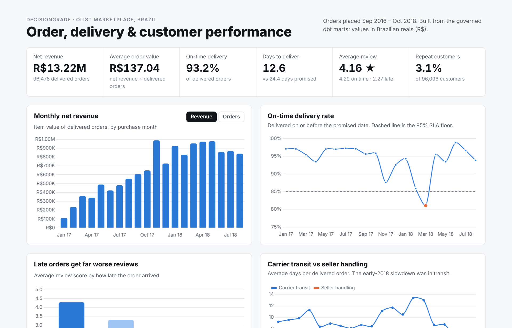
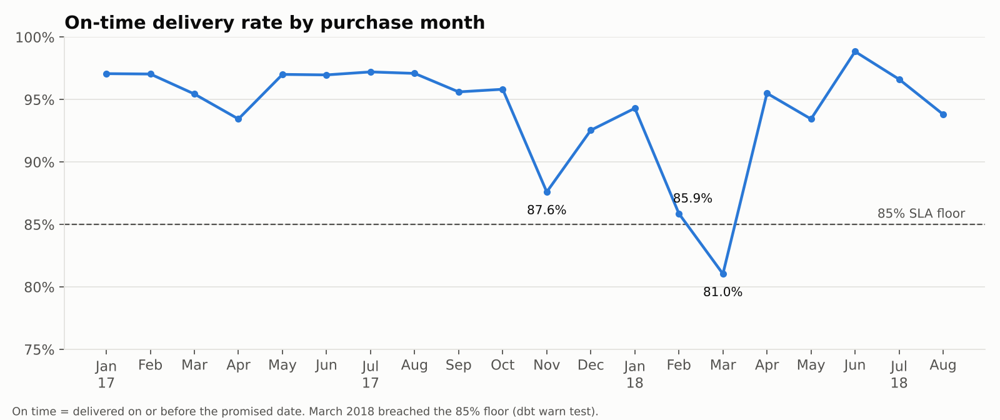

# DecisionGrade Order Analytics System

[](https://github.com/codeind/Decisiongrade-order-analytics/actions/workflows/dbt_ci.yml)

A governed analytics platform built with **SQL and dbt** on the public **Olist Brazilian e-commerce dataset** (99,441 orders, 2016–2018). Raw order, payment, review, customer, seller and product files are modelled through a medallion pipeline into a star schema and a set of governed KPI tables. **90 automated data quality tests** run on every build and in CI on every pull request, and the analysis uses only those governed numbers.

**Stack:** SQL · dbt Core · DuckDB (local) / MotherDuck (cloud) · Python (pandas, matplotlib) · Chart.js · GitHub Actions · Power BI (build guide)

---

## Key results

| | |
|---|---|
| Net revenue (delivered orders) | **R$13.22M** across 96,478 orders, AOV R$137 |
| On-time delivery | **93.2%**, with a breach of the 85% floor in Mar 2018 (81.0%) |
| Reviews | **4.29★** for on-time orders vs **2.27★** for late ones |
| Customers | 96,096, of whom only **3.1%** ordered twice |
| Sellers | top 10% of 2,970 sellers generate **67%** of revenue |
| Data quality | 90 tests: **87 pass, 3 warn, 0 fail** on the full data |



**Late delivery is the strongest driver of bad reviews.** 79% of orders that arrived 8+ days late got a 1–2 star review, against 9% of on-time orders.



**The early-2018 SLA dip came from carriers, not sellers.** Seller handling stayed at ~3 days while carrier transit rose from ~8 to 13 days.

Full write-up with all eight findings, tables and limitations: **[analysis/findings.md](analysis/findings.md)**

---

## Architecture

```
 Bronze (raw CSV)  →  Silver: staging  →  Silver: intermediate  →  Gold: star schema  →  Gold: KPI marts  →  Dashboards
   9 Olist files       8 stg_ models        4 int_ models            3 facts + 5 dims       5 KPI tables        HTML / Power BI
                       type, clean          business rules
```

| Layer | Models |
|---|---|
| Silver: staging | `stg_orders`, `stg_order_items`, `stg_payments`, `stg_reviews`, `stg_customers`, `stg_sellers`, `stg_products`, `stg_geolocation` |
| Silver: intermediate | `int_order_items_summary`, `int_order_payments_summary`, `int_order_reviews`, `int_orders_enriched` (all business rules) |
| Gold: facts | `fact_order_finance` (order), `fact_order_items` (order line), `fact_delivery_performance` (delivered order) |
| Gold: dimensions | `dim_customer`, `dim_product`, `dim_seller`, `dim_location`, `dim_date` |
| Gold: KPIs | `kpi_monthly`, `kpi_delivery_by_state`, `kpi_review_by_lateness`, `kpi_category_performance`, `seller_scorecard` |

Lineage diagram and design rules: [Docs/Architecture.md](Docs/Architecture.md). Column-level lineage: the dbt docs site in [Docs/dbt_docs/index.html](Docs/dbt_docs/index.html).

### Business rules, defined once

- **Revenue** is recognised at delivery and counts item value only; freight is reported separately.
- **On time** means delivered on or before the date promised at checkout.
- **Customers** are counted by `customer_unique_id`, because Olist issues a new `customer_id` per order.
- **Bad source dates** (166 carrier dates earlier than the purchase) are quarantined and flagged, not dropped.

Every formula, grain and owner: [Governance/metric_definitions.md](Governance/metric_definitions.md)

---

## Data quality and governance

- **85 error-severity tests**: unique and not-null keys, referential integrity between every fact and dimension, accepted values, plus custom rules such as "KPI revenue must reconcile to the fact table to the cent". A failure makes dbt skip every downstream model.
- **5 warn-severity tests**: SLA floor, revenue month-over-month anomaly, payment reconciliation rate, invalid ship dates, delivered orders without a date.
- **CI** ([.github/workflows/dbt_ci.yml](.github/workflows/dbt_ci.yml)) runs `dbt build` on a committed 3% sample on every pull request. A failing test fails the check and, with branch protection on, blocks the merge.
- **Change management**: pull request template, CODEOWNERS on metric and test folders, and a change log. See [Governance/change_management.md](Governance/change_management.md).

All 90 tests: [Governance/test_catalog.md](Governance/test_catalog.md) · Rules and results: [Governance/data_quality_rules.md](Governance/data_quality_rules.md)

---

## Dashboard

**Live dashboard:** https://codeind.github.io/Decisiongrade-order-analytics/Dashboards/
**Lineage (dbt docs):** https://codeind.github.io/Decisiongrade-order-analytics/Docs/dbt_docs/



The dashboard ([Dashboards/index.html](Dashboards/index.html)) reads only the governed marts: KPIs, revenue and order trend, on-time rate against the 85% floor, reviews by lateness, carrier vs seller timing, top categories, seller tiers and a sortable state table. Charts have hover tooltips. [Full-page screenshot](Dashboards/screenshots/dashboard_full.png).

A Power BI build guide with the relationship model and DAX measures is in [Dashboards/README.md](Dashboards/README.md).



---

## Run it yourself

```bash
git clone https://github.com/codeind/Decisiongrade-order-analytics.git
cd Decisiongrade-order-analytics
pip install -r requirements.txt

make build                           # dbt: seed, 25 models, 90 tests (~20 s)
make docs                            # lineage site → Docs/dbt_docs/index.html
make analysis                        # charts, KPI exports, dashboard data
```

The raw Olist files are already in `Data/raw/`, so the pipeline runs straight after cloning. `make ci` builds on the small 3% sample instead, which is what GitHub Actions runs.

Cloud warehouse: set `MOTHERDUCK_TOKEN` and run `cd DBT && dbt build --profiles-dir . --target cloud`.

---

## Repository structure

```
├── DBT/                    dbt project: models, tests, seeds, macros, profiles
├── Data/
│   ├── raw/                original Olist CSVs (bronze layer)
│   ├── sample/             3% sample used by CI
│   └── processed/          governed KPI exports for BI tools
├── analysis/
│   ├── run_analysis.py     charts + exports from the marts
│   ├── findings.md         results and recommendations
│   └── charts/             8 charts
├── Dashboards/             interactive HTML dashboard, Power BI guide
├── Governance/             metric definitions, DQ rules, test catalog, change management
├── Docs/                   business context, architecture, decision mapping, data dictionary, dbt docs
├── scripts/                data download, CI sample, doc generation
└── .github/                CI workflow, PR template, CODEOWNERS
```

## Scope and limits

- The Olist data has **no inventory or cost data**, so inventory turnover and GMROI from the original plan are out of scope.
- The data is a public, anonymised sample of a real marketplace, not a complete business.
- Delivery metrics for Jun–Aug 2018 look better than reality because orders still in transit at the data cut-off are excluded.

## Data source

[Brazilian E-Commerce Public Dataset by Olist](https://www.kaggle.com/datasets/olistbr/brazilian-ecommerce), published on Kaggle under CC BY-NC-SA 4.0. The data is used here for non-commercial portfolio purposes with credit to Olist.
