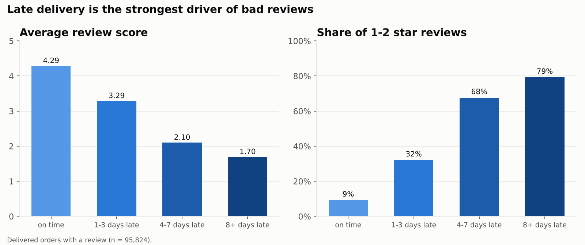
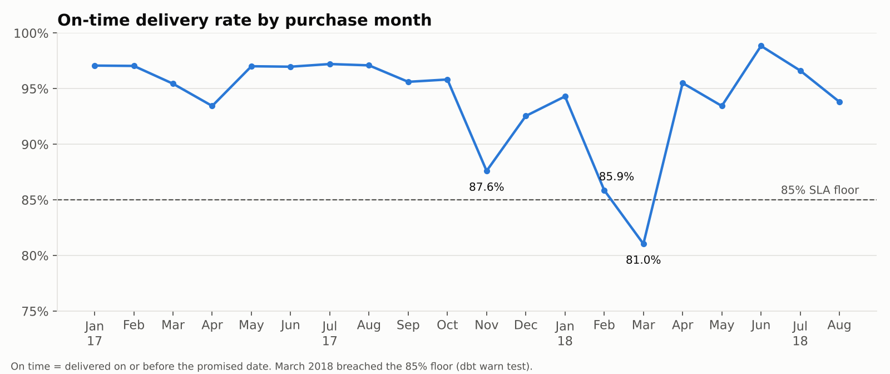
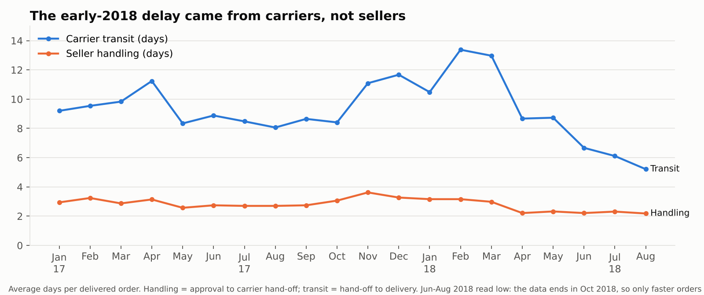
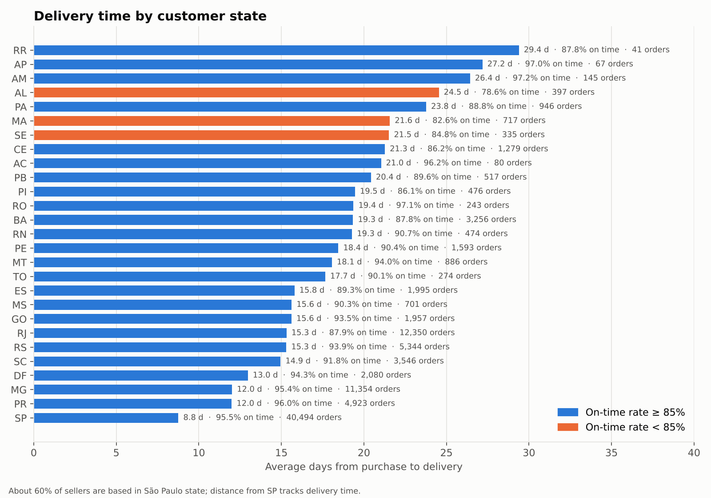
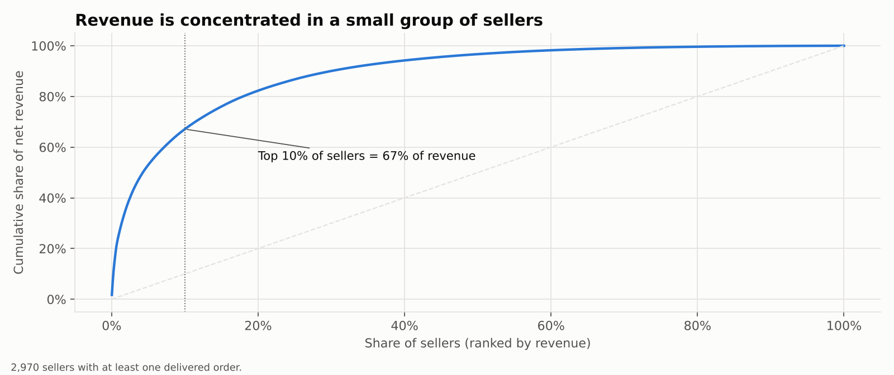
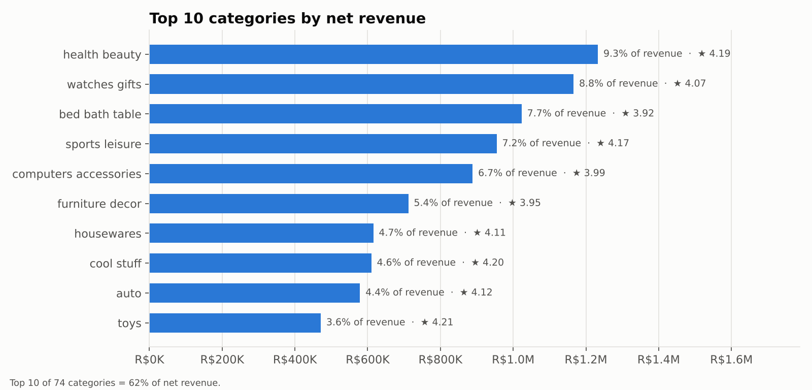
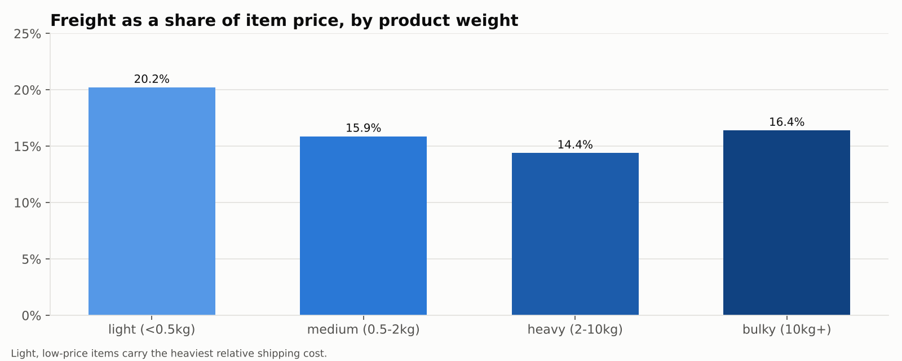

# Findings — DecisionGrade Order Analytics

All numbers below come from the governed dbt marts (`metrics.*` and `core.*`) built on the public Olist Brazilian e-commerce dataset (99,441 orders, Sep 2016 – Oct 2018). Headline figures are regenerated in `analysis/kpi_snapshot.json` every time `analysis/run_analysis.py` runs. Currency is Brazilian reais (R$).

## Headline numbers

| Metric | Value |
|---|---|
| Net revenue (delivered orders, item value) | **R$13.22M** |
| Orders placed / delivered | 99,441 / 96,478 |
| Lost orders (canceled or unavailable) | 1.24% |
| Average order value | R$137.04 |
| On-time delivery rate | **93.2%** |
| Average days to deliver vs promised | 12.6 vs 24.4 |
| Average review score | 4.16 / 5 |
| Repeat customer rate | **3.1%** |
| Revenue from the top 10% of sellers | **67%** |

## 1. Late delivery is the strongest driver of bad reviews

On-time orders average **4.29 stars**; late orders average **2.27**. The damage grows quickly with each day of delay:

| Lateness | Orders | Avg review | 1–2 star share |
|---|---|---|---|
| On time | 89,443 | 4.29 | 9% |
| 1–3 days late | 1,852 | 3.29 | 32% |
| 4–7 days late | 1,748 | 2.10 | 68% |
| 8+ days late | 2,781 | 1.70 | 79% |

**So what:** delivery reliability matters more to customer satisfaction than anything else in the data. Even a 1–3 day slip triples the share of negative reviews.

## 2. Two SLA dips, both caused by carriers rather than sellers

On-time delivery fell to **87.6%** in Nov 2017 (Black Friday; 1,176 orders on 24 Nov alone) and to **85.9%** and **81.0%** in Feb and Mar 2018. March 2018 breached the 85% floor, and the `assert_on_time_rate_floor` dbt test flags it as a warning on every build.

Seller handling time stayed flat at about 3 days through both dips. Carrier transit time rose from about 8.4 days (Oct 2017) to **13.4 days** (Feb 2018). The problem was in the logistics network, so a seller-focused fix would not have helped.

**So what:** monitor carrier transit time as its own KPI, and add capacity or buffer days before known peaks such as Black Friday.

## 3. Delivery promises are padded by about 12 days

The average promised window is 24.4 days; the average actual delivery is 12.6 days (median buffer 12.4 days). That buffer keeps the on-time rate high, but a long promise at checkout can cost conversions. The data supports testing tighter estimates for routes that are consistently fast, such as SP to SP.

## 4. Geography: distance from São Paulo sets delivery time

About 60% of sellers (and 64% of seller revenue) are in São Paulo state. Customers in SP get orders in **8.8 days** on average; customers in the North region wait **22.6 days**.

| Region | Delivered orders | On time | Days to deliver | Avg freight |
|---|---|---|---|---|
| Southeast | 66,193 | 93.9% | 10.8 | R$19.83 |
| South | 13,813 | 94.1% | 14.0 | R$24.35 |
| Central-West | 5,624 | 93.5% | 15.0 | R$26.49 |
| Northeast | 9,044 | **87.3%** | 20.0 | R$35.99 |
| North | 1,796 | 91.4% | 22.6 | R$41.35 |

Three states fall below the 85% floor: Alagoas (78.6%), Maranhão (82.6%) and Sergipe (84.8%). Rio de Janeiro deserves attention because of its volume: 12,350 orders at 87.9% on time, versus 95.5% for SP.

**So what:** the Northeast has the worst reliability, not the longest distance. Promised dates there are too tight for the actual transit times, and those customers already pay the second-highest freight.

## 5. Revenue depends on a small group of sellers

The top 10% of the 2,970 sellers with sales generate **67%** of net revenue; the top 20% generate 82%. The seller scorecard sorts sellers with at least 20 delivered orders into tiers:

| Tier | Sellers | Share of revenue | On time | Review |
|---|---|---|---|---|
| Top performer | 231 | 17.2% | 97.3% | 4.47 |
| Standard | 538 | 61.2% | 92.7% | 4.08 |
| At risk | 35 | 4.0% | 81.8% | 3.35 |
| Insufficient volume (<20 orders) | 2,166 | 17.6% | 92.9% | 4.18 |

**So what:** 35 at-risk sellers carry R$533K of revenue with poor delivery and reviews. They are a short, specific list for the seller-success team.

## 6. Almost every customer buys once

Only **3.1%** of 96,096 customers placed more than one order, and they account for 5.8% of revenue. Growth in this period came from acquisition, not retention. Given finding 1, late deliveries are a likely reason first-time buyers do not return. Testing that would need data the dataset does not include, such as marketing touches.

## 7. Category and freight

The top 10 of 74 categories make up 62% of net revenue, led by health & beauty (9.3%) and watches & gifts (8.8%). Bed, bath & table is third by revenue but has one of the lower review averages (3.92).

Freight equals **20.2%** of item price for light products (under 0.5 kg), against 14.4% for heavy ones (2–10 kg). Cheap, light items carry the heaviest relative shipping cost, which supports free-shipping thresholds or bundling.

## 8. Payments

Credit cards pay for 75.5% of delivered orders, with an average of 3.5 instalments; boleto (bank slip) pays for 19.9%. Payments reconcile to items + freight within R$1 for 99% of orders; the rest are flagged by `is_payment_mismatch` in `fact_order_finance`.

## Data quality issues found and handled

| Issue | Rows | Handling |
|---|---|---|
| Carrier hand-off date earlier than purchase date | 166 | Date nulled in `int_orders_enriched`, order flagged; warn test reports the count |
| Status "delivered" with no delivery date | 8 | Counted as revenue, excluded from delivery KPIs; warn test |
| Orders with more than one review | ~550 | Latest review kept per order |
| Geolocation: ~1M points, many duplicates per zip | 1,000,163 | Reduced to one median coordinate per zip prefix, points outside Brazil dropped |
| Source columns misspelled (`product_name_lenght`) | — | Renamed in staging |
| Partial months at the start and end of the data | 5 months | Flagged `is_complete_month = false` and excluded from trends |

## Limits of this analysis

- Olist has no inventory, cost or margin data, so inventory turnover and GMROI from the original plan cannot be computed. They are out of scope rather than estimated.
- The dataset is a public, anonymised sample of Olist's marketplace, not the complete business.
- Delivery metrics for Jun–Aug 2018 read better than reality, because orders still in transit when the data was cut off are excluded.
- Findings are correlations from observational data. "Late delivery drives bad reviews" is strongly supported by the size of the gap, but it is not a controlled experiment.
